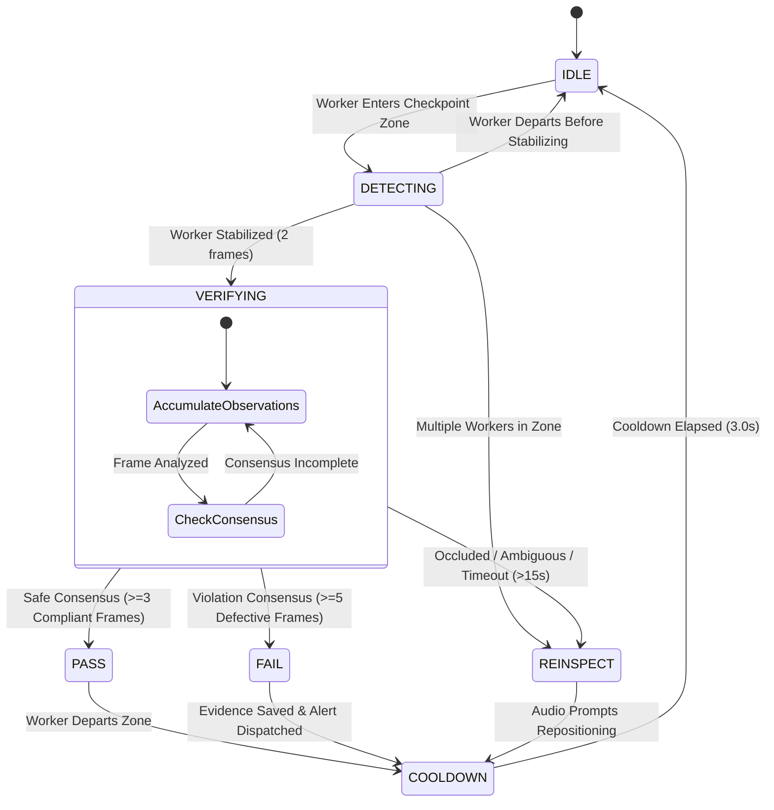

# MineGuard AI: Intelligent PPE Checkpoint Quality Inspection Station

[](https://www.python.org/)
[](https://pytorch.org/)
[](https://docs.ultralytics.com/)
[-10B981.svg)](tests/)
[](LICENSE)

---

## 1. System Overview & Core Architecture

**MineGuard AI** is a production-grade, deep learning-based automated PPE quality inspection station engineered for underground coal mine portals and critical checkpoints. Rather than relying on continuous surveillance tracking (which suffers from identity swaps, occlusions, and privacy profiling), MineGuard AI operates on an **assembly-line checkpoint model**:

1. **Fixed-Point Checkpoint Geometry**: A calibrated spatial inspection zone ($X \in [15\%, 85\%], Y \in [5\%, 98\%]$) with worker height thresholds ($\ge 130\text{px}$) and strict singularity enforcement (exactly one worker at a time).
2. **Ephemeral Inspection References**: Every worker visit generates an independent, privacy-preserving reference ID (`INSP-YYYYMMDD-HHMMSS-XXXX`). No biometric profiling or facial recognition is used.
3. **Calibrated Per-Class YOLO11n Inference**: Dedicated per-class confidence thresholds (`Person: 0.35`, `Hardhat: 0.28`, `Safety Vest: 0.35`) running under `torch.inference_mode()` with sub-20ms inference on NVIDIA RTX 3050.
4. **Anatomical Geometric Association**: Strict normalized head (top 35%) and torso (18% to 75%) bounding zone bipartite matching with inter-person occlusion detection.
5. **Multi-Frame Consensus State Machine**:
   - `IDLE`: Station awaiting worker arrival.
   - `DETECTING`: Worker detected in zone; stabilizing position for 2 consecutive frames.
   - `VERIFYING`: Accumulating multi-frame observations.
   - `PASS`: Verified safe with $\ge 3$ consecutive compliant frames.
   - `FAIL`: Confirmed violation with $\ge 5$ consecutive non-compliant frames.
   - `REINSPECT`: Ambiguous visibility, inter-person occlusion, multiple workers, or timeout (15s). **UNKNOWN is strictly NEVER converted to SAFE**.
6. **Dual-Evidence Capture**: Violations automatically capture synchronized pairs of raw untouched sensor images and annotated YOLO bounding-box snapshots saved to `outputs/violations/YYYY-MM-DD/`.

---

## 2. Checkpoint State Machine Flow



---

## 3. Real Model Evaluation Performance

Evaluated on the held-out test split of 169 images and 791 ground-truth annotations:

| Class | Precision (P) | Recall (R) | F1-Score | mAP@50 | mAP@50-95 |
| :--- | :---: | :---: | :---: | :---: | :---: |
| **Overall (All Classes)** | **90.63%** | **76.70%** | **83.09%** | **77.35%** | **44.76%** |
| **Person** | 89.72% | 69.38% | 78.25% | 68.96% | 40.54% |
| **Hardhat** | 95.00% | 77.99% | 85.66% | 79.76% | 44.59% |
| **Safety Vest** | 87.17% | 82.73% | 84.89% | 83.33% | 49.14% |

- **Inference Latency (GPU RTX 3050)**: ~15-18 ms per frame (>55 FPS)
- **Inference Latency (CPU fallback)**: ~54 ms per frame (~18.5 FPS)

---

## 4. Web Application & Dashboard Architecture

The Flask application exposes a complete dark-industrial operational interface across 7 dedicated pages:

| Page | URL Route | Core Purpose |
| :--- | :--- | :--- |
| **Overview Dashboard** | `/` | Executive KPIs, station status, live feed preview, recent audits. |
| **Live Checkpoint** | `/live` | Primary operator console: 68% video stream, 32% live consensus panel with decision banners and station controls. |
| **Inspection History** | `/history` | Searchable, paginated audit log with reference filter, details modal, and CSV export. |
| **Violations Audit** | `/violations` | Confirmed violation gallery with dual-evidence comparison (Raw vs Annotated), deletion, and clear history. |
| **Safety Analytics** | `/analytics` | Interactive Chart.js visualizations: Daily trends, Decision distribution, PPE defects, and hourly shift load. |
| **Safety Reports** | `/reports` | Executive summary cards, date range filtering, shift breakdown table, and instant CSV download / print. |
| **System Settings** | `/settings` | Real hardware health telemetry (GPU VRAM, FPS, DB size), per-class thresholds, consensus parameters, and database maintenance. |

---

## 5. Directory Layout

```
MineGuard/
├── app.py                     # Flask application entry point with graceful shutdown
├── config.py                  # Centralized application and hardware configuration
│
├── inspection/                # Core Checkpoint Inspection Engine
│   ├── __init__.py
│   ├── inspection_result.py   # State, decision, observation dataclasses
│   ├── inspection_trigger.py  # Spatial zone filtering, height & singularity check
│   ├── frame_collector.py     # Multi-frame observation and evidence buffer
│   ├── ppe_verifier.py        # Consensus engine (Safe=3, Fail=5, Timeout=15s)
│   └── inspection_manager.py  # State machine coordinator & ref generator
│
├── detection/
│   ├── detector.py            # Calibrated YOLO11n PPE detector (torch.inference_mode)
│   ├── tracker.py             # Optional visualization tracker (ByteTrack fallback)
│   └── webcam.py              # Standalone CLI checkpoint demo
│
├── compliance/
│   ├── association.py         # Normalized anatomical head/torso bipartite matching
│   └── compliance.py          # Frame-level PPE compliance evaluation
│
├── backend/
│   ├── camera_service.py      # Background worker thread, frame buffer & MJPEG stream
│   ├── database.py            # SQLite layer (inspections, violations, WAL mode)
│   ├── alert_manager.py       # Notification and alarm sound dispatcher
│   └── routes.py              # REST API endpoints and template controllers
│
├── templates/                 # 7 Dedicated HTML Dashboard Pages
│   ├── base.html              # Layout, navigation, audio synthesizer, toast alerts
│   ├── index.html             # Overview Dashboard
│   ├── live_inspection.html   # Primary Operator Terminal (68% feed / 32% panel)
│   ├── inspection_history.html# Audit table with search & details modal
│   ├── violations.html        # Dual-evidence violation gallery
│   ├── analytics.html         # Chart.js safety trends
│   ├── reports.html           # Periodic safety reports & export
│   └── settings.html          # Hardware telemetry & config editor
│
├── static/
│   ├── css/style.css          # Industrial dark theme styles
│   └── js/                    # Page-specific frontend controllers
│       ├── live_inspection.js
│       ├── history.js
│       ├── charts.js
│       ├── reports.js
│       ├── settings.js
│       └── dashboard.js
│
├── models/
│   ├── pretrained/yolo11n.pt  # Original weights
│   └── trained/best.pt        # Fine-tuned Atharion weights
│
├── outputs/
│   ├── training/evaluation/   # per_class_metrics.csv, evaluation_report.txt
│   └── violations/YYYY-MM-DD/ # Dual evidence images (annotated + raw)
│
├── tests/                     # Comprehensive Unit & Integration Test Suite
│   ├── test_inspection_engine.py
│   ├── test_database.py
│   ├── test_routes.py
│   └── run_all_tests.py
└── database/mineguard.db      # SQLite production database
```

---

## 6. How to Run

### Run the Web Dashboard
```bash
python app.py
```
Open your browser to: **http://127.0.0.1:5000**

### Run the Complete Test Suite
```bash
python tests/run_all_tests.py
```
*Result: 22 tests passing with 100% success rate across inspection state machine, SQLite database persistence, and REST APIs.*

### Run Model Evaluation
```bash
python training/evaluate.py
```

### Run Standalone CLI Terminal
```bash
python detection/webcam.py
```

---

## 7. Safety-Critical Design Guarantees

1. **Zero False-Safe Compromise**: Under no circumstances does an `UNKNOWN` or occluded observation convert into a `PASS`. Insufficient visibility strictly resolves to `REINSPECT`.
2. **Singularity Enforcement**: If multiple workers enter the camera zone simultaneously, the station denies evaluation with a clear `REINSPECT: Multiple workers in zone` prompt to avoid identity cross-contamination.
3. **Storage Protection**: Clearing historical logs touches only SQLite inspection/violation tables; AI models, weights, and training datasets are strictly immutable.
